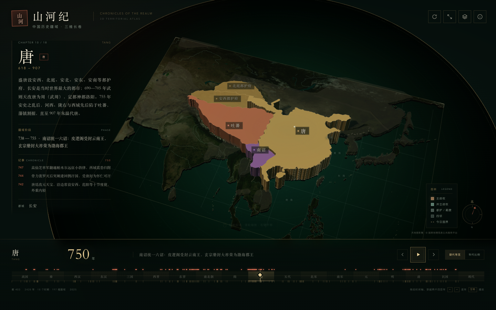
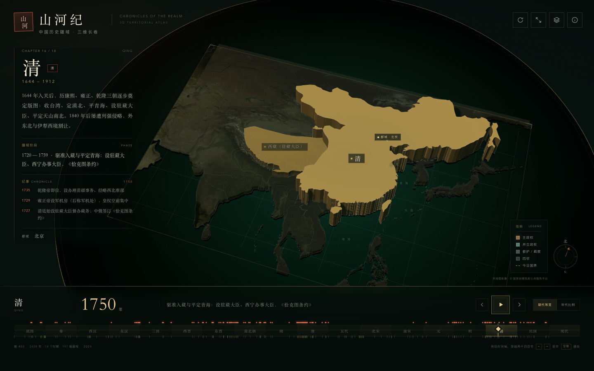
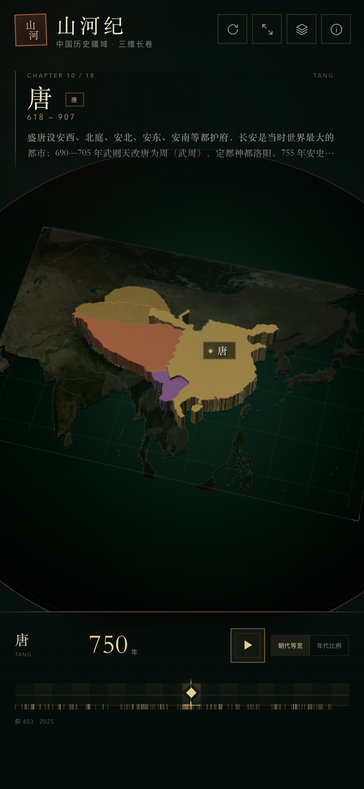

# 山河纪 · 中国历史疆域三维长卷

一幅可以拖动时间轴的中国历史疆域 3D 地图。从公元前 403 年三家分晋到 2025 年，十八个历史时期、一百九十余幅疆域阶段，在同一个可旋转、可缩放的三维沙盘上连续展开。

**直接双击 `index.html` 即可使用**。页面、疆域数据、地形底图和依赖全部打包在一个文件里，不需要本地服务器。



清代最大疆域：



移动端：



## 可以做什么

- **拖动时间轴**：在底部朝代带任意拖动，年份、朝代、疆域阶段实时联动；也可以直接点击任意朝代。
- **两种时间刻度**：默认「朝代等宽」，让秦、三国这类短命王朝也有一席之地；可切换为「年代比例」，按真实年数展开。
- **自动播放**：按空格或点击播放按钮，约一百秒走完两千四百年。
- **真正的三维疆域**：主政权、并立政权、都护/羁縻、四邻以不同高度、材质和透明度堆叠；拖动可以旋转视角，滚轮/双指缩放，右键/双指平移。
- **今日地形底图**：真实高程生成的晕渲地形，叠加今日海岸线、江河湖泊和经纬网；可选开启天地图卫星影像。
- **历史纪事**：每期重要事件随年份出现；都城以金色信标标记，点击政权可聚焦。
- **移动端**：竖屏自动重构地图与信息面板，支持单指旋转、双指缩放平移。

### 快捷键

| 按键 | 作用 |
| --- | --- |
| `←` / `→` | 前后一年 |
| `Shift` + `←` / `→` | 前后十年 |
| `空格` | 播放 / 暂停 |
| `Home` / `End` | 跳到起点 / 终点 |
| `R` | 自动旋转 |
| `0` | 复位视角 |
| `+` / `-` | 放大 / 缩小 |
| `Esc` | 关闭弹层 |

### 图层

右上角图层按钮可开关：四邻政权、江河湖海、今日国界、政权名称、天地图影像、经纬网、光影。

## 天地图影像

「天地图影像」默认开启，使用项目内的浏览器端 Key 拉取 z=5 卫星瓦片，拼成一张覆盖东亚的等距圆柱投影底图，再贴到三维地形上。瓦片加载失败会自动回退到离线地形浮雕，不会影响使用。

天地图的浏览器端 Key 需要在[天地图控制台](https://console.tianditu.gov.cn/)配置域名白名单。当前项目使用的域名：

- `xiaocoer-cloud.github.io`（GitHub Pages）
- `localhost`
- `127.0.0.1`（本地调试）

如果部署到其他域名，请把域名加入白名单，或修改 `src/app.js` 里的 `TDT_KEY`。天地图影像版权归国家地理信息公共服务平台所有；未开启时页面完全离线可用。

## 目录

```
index.html            最终单文件成品（约 3.4 MB）
atlas-data.json       整理后的疆域、阶段、事件与底图数据
src/template.html     页面骨架
src/style.css         界面样式
src/app.js            三维场景、时间轴与交互
vendor/three.module.js three.js r160
assets/terrain.jpg    离线地形晕渲图（由高程瓦片生成）
build-terrain.mjs     生成地形晕渲图
build.mjs             把源码、数据、three.js 和地形图打包为 index.html
preview.png           桌面端预览
preview-qing.png      清代最大疆域预览
preview-mobile.png    移动端预览
```

重新构建：

```bash
# 可选：重新生成地形晕渲图（需要联网下载 70 张高程瓦片）
node build-terrain.mjs

# 打包单文件
node build.mjs
```

`build-terrain.mjs` 使用 z=5 的 Mapzen / AWS Terrain Tiles 高程瓦片，先拼成墨卡托影像，再重采样为等距圆柱投影，计算山体阴影并输出 `assets/terrain.jpg`。依赖根目录已安装的 `sharp`。

## 数据与授权

- **历史政权轮廓**：改编自开源项目 [江山时序 / Chronicles of the Realm](https://github.com/DeanChensj/jiangshan-map)（GPL-3.0）。该项目轮廓源自 [historical-basemaps](https://github.com/aourednik/historical-basemaps)，并据史籍校订。
- **海岸线、河流、湖泊**：[Natural Earth](https://www.naturalearthdata.com/)（公有领域）。
- **地形高程与晕渲**：[AWS Terrain Tiles](https://registry.opendata.aws/terrain-tiles/) / [Mapzen](https://www.mapzen.com/)（CC-BY 4.0；原始高程来自 SRTM 等公开数据）。
- **天地图影像**：[国家地理信息公共服务平台](https://www.tianditu.gov.cn/)，按天地图服务条款使用。
- **三维引擎**：[three.js](https://threejs.org/) r160（MIT）。
- **本项目代码与整理数据**：GPL-3.0，见 [LICENSE](LICENSE)。

### 关于准确性

历史疆域没有唯一、精确的边界。本图中的所有轮廓均为**示意性近似**，用于呈现疆域大势与历史变迁，不可作为边界依据。部分政权并立、羁縻、都护与藩属关系以简化方式表达。若用于教学、出版或正式展示，请核对原始史料与权威历史地图集。

## 部署

静态页面，无需构建服务。以 GitHub Pages 为例：

```bash
cd /Users/xiaxinxia/deepseek-harness/tuoshui-frontend
scripts/deploy-github-pages.sh --dir shanhe-3d --repo shanhe-3d
```

发布后地址为 `https://xiaocoer-cloud.github.io/shanhe-3d/`。部署前请确认天地图白名单已包含 `xiaocoer-cloud.github.io`。
